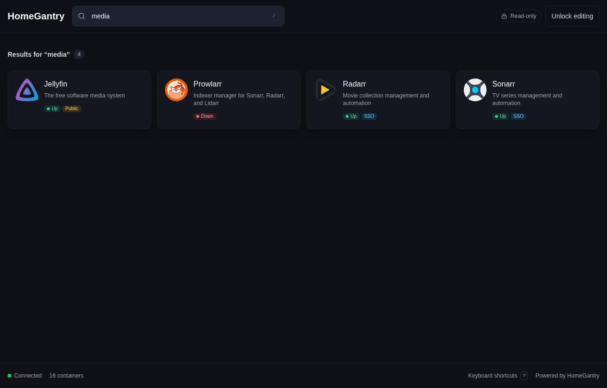
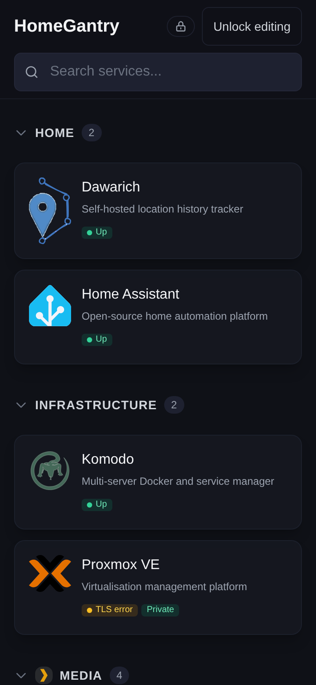

# HomeGantry

[](https://github.com/geraldvd/homegantry/actions/workflows/ci.yml)
[](LICENSE)

**Auto-discovering Docker homelab dashboard with real-time updates.**

HomeGantry watches your Docker daemon for running containers, matches them against a built-in knowledge base of 200+ services, and presents them in a clean dashboard — no manual configuration required.

> **Status: pre-1.0, under active development.** Expect breaking changes between releases. See the
> [roadmap](docs/MISSION.md#how-it-is-built).


<sub>Screenshot from dev mode with example containers (`npm run dev:fixture`).</sub>

## Features

- **Auto-discovery** — Detects running Docker containers and identifies them from a knowledge base of 200+ services
- **Easy to extend** — One small YAML file per service; editors see which images are not recognised yet
- **Icons your way** — dashboard-icons from a CDN, your own mirror, or off (no external requests)
- **Real-time updates** — Server-Sent Events push changes instantly, no polling or page refresh
- **Traefik discovery** — Reads router labels, or the optional Traefik API to also find non-Docker services (Proxmox, a NAS, ...)
- **Exposure badges** — Shows whether a service is public, behind SSO or private (LAN/VPN only), derived from its Traefik middlewares
- **Health checks** — One clear status per card (up, down, running, stopped), with a per-service opt-out in the UI or a label
- **Fast search** — Press `/`, type, press Enter: matches names, descriptions, categories, stacks and hosts; bookmarkable (`?q=`)
- **Keyboard friendly** — Arrow keys between cards, Enter to open, `e` to edit, `?` for all shortcuts
- **Grouping** — By category, Compose stack or URL host, with collapsible groups
- **Phones and tablets** — Usable from 360 px wide, with 44 px touch targets and full-screen dialogs
- **Homepage compatibility** — Reads `homepage.*` Docker labels for easy migration from [Homepage](https://gethomepage.dev/)
- **Stack management** — Group services by Docker Compose project, toggle visibility per-stack
- **Manual services** — Add non-Docker services to the dashboard through the UI
- **Customizable** — Override names, icons, categories, and URLs per-service
- **Dark mode glass-morphism UI** — Responsive grid and list layouts

<p>
  
  
</p>

## Quick Start

```yaml
# docker-compose.yml
services:
  homegantry:
    image: ghcr.io/geraldvd/homegantry:latest
    ports:
      - '3000:3000'
    volumes:
      - /var/run/docker.sock:/var/run/docker.sock:ro
      - homegantry_data:/data
    environment:
      - HOMEGANTRY_HOST=192.168.1.100
    restart: unless-stopped

volumes:
  homegantry_data:
```

```bash
docker compose up -d
```

Open [http://localhost:3000](http://localhost:3000).

> **Requirements:** Docker Engine 20.10+ and Docker Compose v2. No reverse proxy needed — Traefik integration is optional. See the [Getting Started](https://homegantry.com/guide/getting-started) guide for details.

### Image tags and versions

Images for `linux/amd64` and `linux/arm64` (Raspberry Pi and other 64-bit ARM boards) are on
`ghcr.io/geraldvd/homegantry`:

| Tag                    | What it is                                                                     |
| ---------------------- | ------------------------------------------------------------------------------ |
| `0.2` (recommended)    | The newest `0.2.x` release: fixes, no breaking changes. Pin this one.          |
| `0.2.0`                | Exactly that release.                                                          |
| `latest`               | The newest release. Moves only on a release, never on a plain merge to `main`. |
| `main`, `sha-<commit>` | Development builds of `main`. Not for production.                              |

Before 1.0, a new minor version (`0.3.0`) may contain breaking changes: read the [CHANGELOG](CHANGELOG.md) before
moving to it. Each [GitHub release](https://github.com/geraldvd/homegantry/releases) has its notes and the SBOM of
its image; every image is scanned for known vulnerabilities and carries SBOM and provenance attestations. The
running version is shown in the dashboard footer and in `GET /api/health`. Details:
[Releases and upgrading](https://homegantry.com/guide/releases).

## Security

HomeGantry is **read-only by default**: anyone who can open the dashboard can look, but every change (overrides,
manual services, stacks, settings) is refused until you enable editing with one of:

- `HOMEGANTRY_ADMIN_TOKEN` (at least 24 characters): click **Unlock editing** in the UI and enter it, or send it as
  `Authorization: Bearer <token>`;
- `HOMEGANTRY_AUTH_HEADER` + `HOMEGANTRY_TRUSTED_PROXIES`: let your forward-auth proxy (Authelia, Authentik, ...) tell
  HomeGantry who is signed in.

`HOMEGANTRY_READONLY=true` switches editing off completely. The API never returns container env vars, mounts or
secret-looking labels, and HomeGantry never starts, stops or removes containers. For the Docker socket we recommend a
read-only socket proxy ([`examples/compose.socket-proxy.yaml`](examples/compose.socket-proxy.yaml)).

Details: [Security model](https://homegantry.com/guide/security). To report a vulnerability, see
[SECURITY.md](SECURITY.md).

## Configuration

| Variable                     | Default      | Description                                                    |
| ---------------------------- | ------------ | -------------------------------------------------------------- |
| `HOMEGANTRY_HOST`            | _(empty)_    | Host/IP for building service URLs (e.g. `192.168.1.100`)       |
| `HOMEGANTRY_TITLE`           | `HomeGantry` | Dashboard title                                                |
| `HOMEGANTRY_POLL_INTERVAL`   | `60`         | Seconds between full Docker rescans                            |
| `HOMEGANTRY_SHOW_STOPPED`    | `false`      | Show stopped containers                                        |
| `HOMEGANTRY_HOMEPAGE_COMPAT` | `true`       | Read `homepage.*` Docker labels                                |
| `HOMEGANTRY_EXCLUDE_SELF`    | `true`       | Hide the HomeGantry container                                  |
| `HOMEGANTRY_COMPOSE_ONLY`    | `true`       | Only show containers from Compose projects                     |
| `HOMEGANTRY_ICON_SOURCE`     | `cdn`        | Icons: `cdn`, a self-hosted base URL, or `off`                 |
| `HOMEGANTRY_ADMIN_TOKEN`     | _(empty)_    | Token that unlocks editing (≥ 24 characters)                   |
| `HOMEGANTRY_AUTH_HEADER`     | _(empty)_    | Forward-auth header that allows editing (e.g. `Remote-User`)   |
| `HOMEGANTRY_TRUSTED_PROXIES` | _(empty)_    | IPs/CIDRs of the proxy allowed to set that header              |
| `HOMEGANTRY_READONLY`        | `false`      | Disable editing completely                                     |
| `HOMEGANTRY_TRAEFIK_API_URL` | _(empty)_    | Traefik API for discovery (e.g. `http://traefik:8080`)         |
| `HOMEGANTRY_EXPOSURE_MAP`    | _(empty)_    | Middleware-to-exposure mapping (`my-sso=sso,office-*=private`) |
| `HOMEGANTRY_HEALTHCHECK`     | `true`       | HTTP health checks                                             |

See the [full configuration reference](https://homegantry.com/guide/configuration) for all options.

## Docker Labels

Control how services appear on the dashboard using container labels:

```yaml
labels:
  homegantry.name: 'My Service'
  homegantry.icon: 'plex'
  homegantry.url: 'https://plex.example.com'
  homegantry.category: 'Media'
```

Homepage labels (`homepage.name`, `homepage.href`, etc.) are also supported. See the [Docker Labels](https://homegantry.com/guide/docker-labels) documentation.

## Documentation

Full documentation is available at [homegantry.com](https://homegantry.com).

- [Getting Started](https://homegantry.com/guide/getting-started) — Requirements and quick start
- [Using the Dashboard](https://homegantry.com/guide/using-the-dashboard) — Search, shortcuts, grouping, mobile
- [Configuration](https://homegantry.com/guide/configuration) — Environment variables reference
- [Docker Labels](https://homegantry.com/guide/docker-labels) — Controlling service display
- [Knowledge Base](https://homegantry.com/guide/knowledge-base) — Matching rules and adding a service
- [Traefik Discovery](https://homegantry.com/guide/traefik) — Traefik API, exposure badges and mapping
- [Health Checks](https://homegantry.com/guide/health-checks) — HTTP status per service
- [Deployment](https://homegantry.com/guide/deployment) — Production deployment guides
- [Releases and Upgrading](https://homegantry.com/guide/releases) — Image tags, changelog, upgrading, SBOM
- [Reverse Proxy](https://homegantry.com/guide/reverse-proxy) — Traefik, Nginx, and Caddy examples
- [Security Model](https://homegantry.com/guide/security) — Read-only default, editing, socket proxy
- [Contributing](https://homegantry.com/guide/contributing) — Development setup and project structure

## Development

```bash
git clone https://github.com/geraldvd/homegantry.git
cd homegantry
npm install
npm run dev
```

This starts both the Express backend and Vite dev server. The frontend is available at `http://localhost:5173` with hot module replacement.

Run the checks with `npm run typecheck`, `npm run lint`, `npm test` and `npm run build`. No Docker? `npm run dev:fixture`
serves a fake example lab. See [CONTRIBUTING.md](CONTRIBUTING.md) for details.

## License

[MIT](LICENSE)
