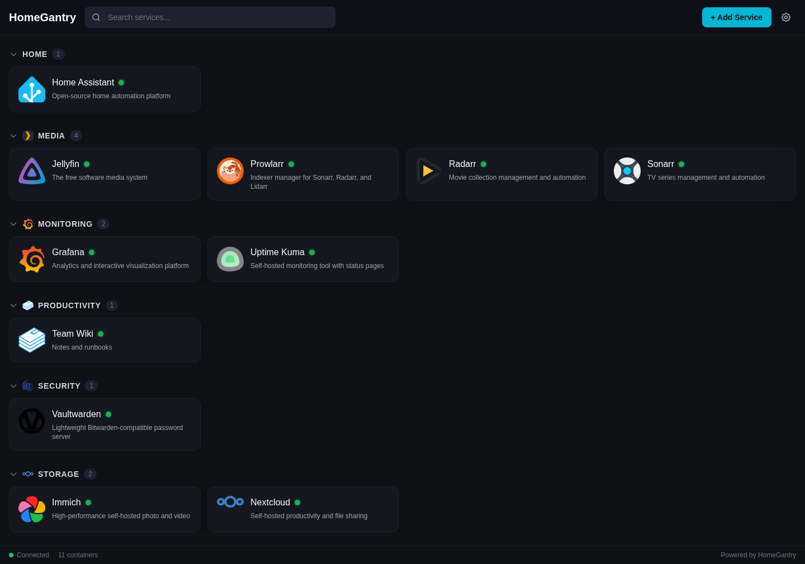

# HomeGantry

[](https://github.com/geraldvd/homegantry/actions/workflows/ci.yml)
[](LICENSE)

**Auto-discovering Docker homelab dashboard with real-time updates.**

HomeGantry watches your Docker daemon for running containers, matches them against a built-in knowledge base of 60+ services, and presents them in a clean dashboard — no manual configuration required.

> **Status: pre-1.0, under active development.** Expect breaking changes between releases. See the
> [roadmap](docs/MISSION.md#how-it-is-built).



<sub>Screenshot from dev mode with example containers (`npm run dev:fixture`).</sub>

## Features

- **Auto-discovery** — Detects running Docker containers and identifies them from a knowledge base of 60+ services
- **Real-time updates** — Server-Sent Events push changes instantly, no polling or page refresh
- **Traefik support** — Extracts service URLs from Traefik `Host()` router rules automatically
- **Homepage compatibility** — Reads `homepage.*` Docker labels for easy migration from [Homepage](https://gethomepage.dev/)
- **Stack management** — Group services by Docker Compose project, toggle visibility per-stack
- **Manual services** — Add non-Docker services to the dashboard through the UI
- **Customizable** — Override names, icons, categories, and URLs per-service
- **Dark mode glass-morphism UI** — Responsive grid and list layouts

## Quick Start

```yaml
# docker-compose.yml
services:
  homegantry:
    image: ghcr.io/geraldvd/homegantry:latest
    ports:
      - '3000:3000'
    volumes:
      - /var/run/docker.sock:/var/run/docker.sock:ro
      - homegantry_data:/data
    environment:
      - HOMEGANTRY_HOST=192.168.1.100
    restart: unless-stopped

volumes:
  homegantry_data:
```

```bash
docker compose up -d
```

Open [http://localhost:3000](http://localhost:3000).

> **Requirements:** Docker Engine 20.10+ and Docker Compose v2. No reverse proxy needed — Traefik integration is optional and only used for URL auto-detection. See the [Getting Started](https://homegantry.com/guide/getting-started) guide for details.

## Security

Until milestone M1 (secure by default) lands, the HomeGantry API has **no authentication**: anyone who can reach it can
edit overrides, settings and manual services. Keep it **behind your LAN, a VPN, or a forward-auth middleware**
(Authelia, Authentik, oauth2-proxy, ...) and do not expose it directly to the internet. HomeGantry only needs the Docker
socket read-only (`:ro`) and never starts, stops or removes containers.

To report a vulnerability, see [SECURITY.md](SECURITY.md).

## Configuration

| Variable                     | Default      | Description                                              |
| ---------------------------- | ------------ | -------------------------------------------------------- |
| `HOMEGANTRY_HOST`            | _(empty)_    | Host/IP for building service URLs (e.g. `192.168.1.100`) |
| `HOMEGANTRY_TITLE`           | `HomeGantry` | Dashboard title                                          |
| `HOMEGANTRY_POLL_INTERVAL`   | `60`         | Seconds between full Docker rescans                      |
| `HOMEGANTRY_SHOW_STOPPED`    | `false`      | Show stopped containers                                  |
| `HOMEGANTRY_HOMEPAGE_COMPAT` | `true`       | Read `homepage.*` Docker labels                          |
| `HOMEGANTRY_EXCLUDE_SELF`    | `true`       | Hide the HomeGantry container                            |
| `HOMEGANTRY_COMPOSE_ONLY`    | `true`       | Only show containers from Compose projects               |

See the [full configuration reference](https://homegantry.com/guide/configuration) for all options.

## Docker Labels

Control how services appear on the dashboard using container labels:

```yaml
labels:
  homegantry.name: 'My Service'
  homegantry.icon: 'plex'
  homegantry.url: 'https://plex.example.com'
  homegantry.category: 'Media'
```

Homepage labels (`homepage.name`, `homepage.href`, etc.) are also supported. See the [Docker Labels](https://homegantry.com/guide/docker-labels) documentation.

## Documentation

Full documentation is available at [homegantry.com](https://homegantry.com).

- [Getting Started](https://homegantry.com/guide/getting-started) — Requirements and quick start
- [Configuration](https://homegantry.com/guide/configuration) — Environment variables reference
- [Docker Labels](https://homegantry.com/guide/docker-labels) — Controlling service display
- [Traefik Integration](https://homegantry.com/guide/traefik) — URL auto-detection from Traefik
- [Deployment](https://homegantry.com/guide/deployment) — Production deployment guides
- [Reverse Proxy](https://homegantry.com/guide/reverse-proxy) — Traefik, Nginx, and Caddy examples
- [Contributing](https://homegantry.com/guide/contributing) — Development setup and project structure

## Development

```bash
git clone https://github.com/geraldvd/homegantry.git
cd homegantry
npm install
npm run dev
```

This starts both the Express backend and Vite dev server. The frontend is available at `http://localhost:5173` with hot module replacement.

Run the checks with `npm run typecheck`, `npm run lint`, `npm test` and `npm run build`. No Docker? `npm run dev:fixture`
serves a fake example lab. See [CONTRIBUTING.md](CONTRIBUTING.md) for details.

## License

[MIT](LICENSE)
